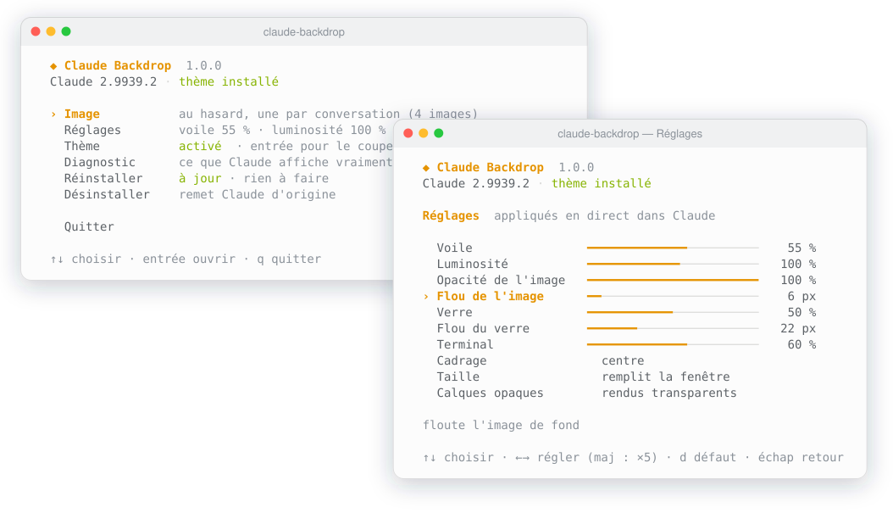
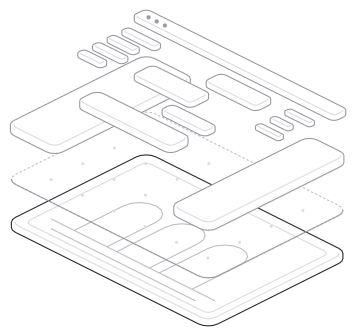
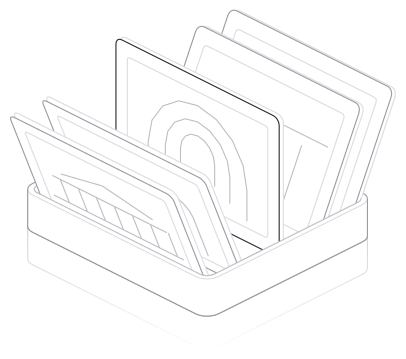
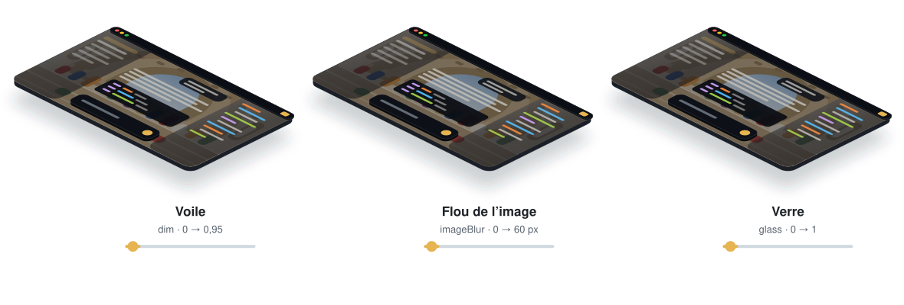

<p align="center">
  <picture>
    <source media="(prefers-color-scheme: dark)" srcset="docs/readme/hero-dark.svg">
    
  </picture>
</p>

<p align="center">
  <b>Un tableau de maître derrière Claude Desktop, et Ayu Dark partout ailleurs.</b><br>
  Le chat, la vue Claude Code, le terminal et les fichiers ouverts laissent voir l'image ;
  la barre latérale et les panneaux deviennent du verre dépoli. Tout se règle en direct, sans redémarrer Claude.
</p>

<p align="center">
  <a href="#installer">Installer</a> ·
  <a href="#démarrage-rapide">Démarrage rapide</a> ·
  <a href="#ce-que-le-thème-change">Ce que ça change</a> ·
  <a href="#les-tableaux">Les tableaux</a> ·
  <a href="#réglages">Réglages</a> ·
  <a href="#comment-ça-marche">Comment ça marche</a> ·
  <a href="#désinstaller">Désinstaller</a>
</p>

<p align="center">
  <a href="https://github.com/M-U-C-K-A/claude-code/releases/latest"></a>
  
  
  <a href="LICENSE"></a>
</p>

> [!WARNING]
> **Non officiel.** L'outil modifie les fichiers internes de Claude Desktop et le re-signe localement. Ça va
> probablement à l'encontre des conditions d'utilisation d'Anthropic, et les mises à jour automatiques de Claude
> échouent tant que le thème est posé (voir [Mises à jour](#mises-à-jour)). À utiliser en connaissance de cause.

## Installer

### Depuis une release (recommandé)

Une seule commande, sans cloner le dépôt ni installer Go :

```bash
curl -fsSL https://github.com/M-U-C-K-A/claude-code/releases/latest/download/install.sh | bash
```

Le script télécharge le binaire de la [dernière release](https://github.com/M-U-C-K-A/claude-code/releases/latest)
(universel : Apple Silicon et Intel), vérifie son empreinte SHA-256 et pose la commande `claude-backdrop` dans
`/usr/local/bin` (ou `/opt/homebrew/bin`, sinon `~/.local/bin`). Le relancer met l'outil à jour.

<details>
<summary>À la main, depuis la page de la release</summary>

Télécharge `claude-backdrop-macos.tar.gz` sur la page des
[releases](https://github.com/M-U-C-K-A/claude-code/releases/latest), puis :

```bash
tar -xzf ~/Downloads/claude-backdrop-macos.tar.gz -C ~/Downloads
xattr -d com.apple.quarantine ~/Downloads/claude-backdrop   # un fichier venu du navigateur est bloqué par Gatekeeper
sudo mv ~/Downloads/claude-backdrop /usr/local/bin/
```

Le binaire est signé localement (ad-hoc), pas par un développeur Apple : sans la ligne `xattr`, macOS refuse de
l'ouvrir (« Apple ne peut pas vérifier… »). Le script `curl` ci-dessus n'a pas ce problème.
</details>

### Depuis les sources

Avec [Go](https://go.dev/dl) 1.24 ou plus (`brew install go`) :

```bash
git clone https://github.com/M-U-C-K-A/claude-code.git
cd claude-code
./claude-backdrop        # compile l'outil au premier lancement, puis l'ouvre
```

Pour avoir la commande partout : `ln -s "$PWD/claude-backdrop" /usr/local/bin/claude-backdrop`. Mettre à jour :
`git pull`, le lanceur recompile tout seul.

## Démarrage rapide

<p align="center">
  <picture>
    <source media="(prefers-color-scheme: dark)" srcset="docs/readme/tui-dark.svg">
    
  </picture>
</p>

1. Lance **`claude-backdrop`** : l'interface s'ouvre dans le terminal (flèches, entrée, échap).
2. Choisis **Installer**. L'outil télécharge les tableaux en 4K, sauvegarde Claude.app, pose le loader, re-signe
   l'app et relance Claude.
3. Au premier lancement, macOS redemande le trousseau (« Claude Safe Storage » → **Toujours autoriser**) et les
   autorisations micro et écran : c'est la nouvelle signature locale, une seule fois.
4. Change d'image ou de réglage quand tu veux : Claude l'applique en direct, sans redémarrer.

> [!TIP]
> Un petit bouton 🖼 apparaît **en haut à droite de Claude** : il ouvre la galerie et deux curseurs, sans passer par
> le terminal. Voir [Le panneau dans Claude](#le-panneau-dans-claude).

macOS peut demander, la première fois, d'autoriser ton terminal dans **Réglages Système › Confidentialité et
sécurité › Gestion des apps** : l'outil doit pouvoir modifier Claude.app.

## Ce que le thème change

<p align="center">
  <picture>
    <source media="(prefers-color-scheme: dark)" srcset="docs/readme/layers-dark.svg">
    
  </picture>
</p>

Chaque fenêtre de Claude devient quatre calques, du fond vers toi :

| Calque | Ce qu'il fait | Se règle avec |
|---|---|---|
| **Tableau** | l'image, en 4K, recadrée, éventuellement floutée | Image, Luminosité, Opacité, Flou de l'image, Cadrage, Taille |
| **Voile** | un voile sombre, pour que le texte reste lisible sur n'importe quel tableau | Voile |
| **Verre** | la barre latérale, les panneaux de Claude Code, la visionneuse de fichiers et le champ de saisie en verre dépoli ; le terminal garde un verre plus sombre et perd son fond | Verre, Flou du verre, Terminal |
| **Contenu** | le texte et les accents aux couleurs d'[Ayu Dark](https://github.com/ayu-theme), or `#E6B450` en signature | — |

Ça vaut pour le chat, la vue **Claude Code** (conversation, diff, fichiers, terminal), les fenêtres ouvertes à
part, les réglages et les menus. Un calque opaque que le thème ne connaît pas encore est repéré et rendu
transparent tout seul ; [`claude-backdrop status`](#dépannage) liste ceux qui resteraient.

## Les tableaux

<p align="center">
  <picture>
    <source media="(prefers-color-scheme: dark)" srcset="docs/readme/paintings-dark.svg">
    
  </picture>
</p>

Par défaut, **chaque conversation reçoit un tableau au hasard**, et le garde si tu recharges. Quatre tableaux du
domaine public, téléchargés depuis Wikimedia Commons à l'installation :

| Tableau | Peintre | Fichier |
|---|---|---|
| *La Mort de Socrate* | Jacques-Louis David, 1787 | `socrates.jpg` |
| *Le Serment des Horaces* | Jacques-Louis David, 1784 | `horatii.jpg` |
| *Pandémonium* | John Martin, 1841 | `pandemonium.jpg` |
| *L'École d'Athènes* | Raphaël, 1509–1511 | `school-of-athens.jpg` |

Ils sont en **4K** (3840 px) quand la source le permet ; *Pandémonium* plafonne à 2843 px, le plus grand scan
disponible. Pour que Claude reste fluide, la page ne reçoit qu'un aperçu de chaque image, puis celle à l'écran en
pleine résolution.

Ils vivent dans `~/Library/Application Support/ClaudeBackdrop/gallery/`, avec tes propres images
(`custom-….jpg`), listées dans `manifest.json`. Tu peux y remplacer un tableau par ta version sous le même nom :
il n'est pas retéléchargé tant qu'il fait au moins 2000 px (16 Mo au plus).

**Ta propre image** : dans l'interface, *Image › Ajouter une image…* (glisse le fichier dans le terminal, ou colle
une URL), ou `claude-backdrop image ~/Images/tableau.jpg`, ou la tuile ＋ du panneau dans Claude. JPEG, PNG, HEIC…
L'image est convertie, redimensionnée et ajoutée à la galerie.

### Le panneau dans Claude

<p align="center">
  <picture>
    <source media="(prefers-color-scheme: dark)" srcset="docs/readme/gallery-dark.svg">
    
  </picture>
</p>

Le bouton 🖼 en haut à droite de Claude ouvre un panneau où tu peux, sans passer par le terminal :

- voir les fonds disponibles et **changer celui de la fenêtre** d'un clic ;
- **ajouter ta propre image** (tuile ＋, réduite puis ajoutée à la galerie) ;
- régler le **flou** et la **luminosité** de l'image ;
- activer ou couper l'**image au hasard par conversation** ;
- **Définir par défaut** l'image affichée, pour toutes les fenêtres.

Le bouton gêne une icône de la barre de titre ? Déplace-le dans `custom.css` :
`#cb-gallery-btn { right: 200px !important; }`.

## Réglages

<p align="center">
  <picture>
    <source media="(prefers-color-scheme: dark)" srcset="docs/readme/settings-dark.svg">
    
  </picture>
</p>

Dans l'interface, **Réglages**, puis ←/→ (maj : ×5, `d` : valeur par défaut). Chaque changement s'applique en
direct dans Claude. Ils sont enregistrés dans `~/Library/Application Support/ClaudeBackdrop/config.json` :

| Réglage | Clé | Défaut | Rôle |
|---|---|---|---|
| Voile | `dim` | `0.55` | voile sombre sur l'image, de 0 à 0.95 |
| Luminosité | `brightness` | `1` | luminosité de l'image, de 0.3 à 1.6 (aussi dans le panneau) |
| Opacité de l'image | `imageOpacity` | `1` | opacité de l'image, de 0.1 à 1 |
| Flou de l'image | `imageBlur` | `6` | flou de l'image en px, de 0 à 60 (aussi dans le panneau) |
| Verre | `glass` | `0.5` | opacité du verre (barre latérale, panneaux), de 0 à 1 |
| Flou du verre | `blur` | `22` | flou derrière le verre en px (0 = verre net) |
| Terminal | `terminalGlass` | `0.6` | opacité du verre derrière le terminal, dont le fond est transparent |
| Cadrage | `position` | `center` | `center`, `top`, `bottom` (ou `50% 20%` à la main) |
| Taille | `size` | `cover` | `cover` (remplit la fenêtre) ou `contain` (image entière) |
| Calques opaques | `autoClear` | `true` | repère et rend transparents les fonds que le thème ne connaît pas |
| Image | `rotate` | `conversation` | `conversation` = au hasard ; `off` = image fixe (`image`) |

Tes propres règles CSS vont dans `custom.css`, à côté : il n'est jamais écrasé. `theme.css` et `page.js`, eux, sont
remplacés à chaque mise à jour de l'outil.

## En ligne de commande

Tout ce que fait l'interface, pour les scripts :

```bash
claude-backdrop                     # ouvre l'interface
claude-backdrop install             # installe (ou met à jour) le thème dans Claude
claude-backdrop uninstall           # remet Claude d'origine (--purge : efface aussi réglages et images)
claude-backdrop image hasard        # une image au hasard par conversation
claude-backdrop image pandemonium   # un tableau fixe : socrates, horatii, pandemonium, school-of-athens
claude-backdrop image ~/Images/x.jpg   # ajoute ton image (fichier ou URL) à la galerie et l'affiche
claude-backdrop on | off            # active / coupe le thème, sans rien désinstaller
claude-backdrop status              # état de l'installation et de ce que Claude affiche
claude-backdrop version
```

`--yes` saute la confirmation, `--app <chemin>` vise un autre Claude.app.

## Mises à jour

Tant que le thème est posé, la signature d'Anthropic est remplacée par une signature locale, et l'updater de Claude
**refuse d'installer** les mises à jour (il vérifie la signature). Pour mettre Claude à jour :

```bash
claude-backdrop uninstall   # remet le vrai Claude signé Anthropic : la mise à jour automatique remarche
# laisse Claude se mettre à jour (menu Claude › Rechercher les mises à jour), puis :
claude-backdrop install     # repose le thème sur la nouvelle version
```

La désinstallation remet exactement le Claude.app d'origine à partir de la copie faite à l'installation (signature
comprise). Après une mise à jour subie, l'installation détecte la nouvelle version et repose tout proprement.

Pour mettre **l'outil** à jour : relance le script d'installation (ou `git pull` dans le dépôt). Le thème et le
script de page se mettent à jour en direct ; le loader n'est réinstallé dans Claude que s'il a changé.

## Désinstaller

```bash
claude-backdrop uninstall            # Claude revient à l'original
claude-backdrop uninstall --purge    # + supprime réglages, images et sauvegardes
```

Si la copie complète manque (installé avec `--no-app-backup`), la désinstallation retire quand même le loader ; pour
retrouver la signature d'Anthropic, réinstalle Claude depuis [claude.ai/download](https://claude.ai/download).
La commande elle-même s'enlève avec `rm "$(command -v claude-backdrop)"`.

## Comment ça marche

Claude Desktop refuse les options de débogage : impossible d'y injecter du style de l'extérieur. La seule voie sur
macOS aujourd'hui :

1. un petit **loader** est ajouté à la fin du script principal, dans `Claude.app/Contents/Resources/app.asar` ;
2. l'**empreinte d'intégrité** (`ElectronAsarIntegrity`) est recalculée dans les `Info.plist` du bundle ;
3. l'app est **re-signée localement** (ad-hoc), avec les entitlements dont Claude a besoin (micro, caméra,
   virtualisation pour Cowork). Une copie complète de Claude.app est gardée pour la désinstallation.

Le loader ne change jamais : il lit tout dans `~/Library/Application Support/ClaudeBackdrop/` et **recharge en
direct** dès qu'un fichier change. Il injecte le thème avec `webContents.insertCSS(…, { cssOrigin: "user" })` :
dans cette origine, une règle `!important` passe devant toutes celles de l'app, d'où chaque token de couleur de
Claude redéfini en `!important`. Un script de page (`page.js`, lui aussi lu en direct) peint le tableau, rend
transparents les calques opaques que le CSS ne connaît pas par leur nom, met les panneaux et le terminal sous verre,
et ajoute le panneau galerie.

### Dépannage

`claude-backdrop status` (ou **Diagnostic** dans l'interface) demande à Claude un relevé frais : version et
intégrité de l'app, signature, et pour chaque fenêtre si l'image est affichée, combien de calques sont devenus
transparents ou du verre, et lesquels restent opaques, avec leur sélecteur. Le relevé complet est dans
`status.json`, à côté des réglages. Un calque opaque qui résiste se corrige dans `custom.css`, en attendant une
mise à jour de l'outil.

### Sécurité et limites

- La signature d'Anthropic (et son *hardened runtime*) est remplacée par une signature locale : l'app est moins
  protégée contre l'injection de code.
- Les mises à jour automatiques échouent tant que le thème est posé (voir [Mises à jour](#mises-à-jour)). Elles
  peuvent contenir des correctifs de sécurité.
- Le thème pose du CSS et un script d'affichage ; il ne lit ni n'envoie tes conversations. Tout reste local.
- Claude change sa structure d'une version à l'autre : certains éléments peuvent redevenir opaques après une mise
  à jour. Le diagnostic les liste.

## Développement

```bash
go test ./...        # patch, intégrité, idempotence et restauration de app.asar ; thème ; galerie ; scripts
go vet ./...
./claude-backdrop selftest --asar /chemin/vers/app.asar   # essaie le patch sur une copie, sans rien modifier
```

```text
cmd/claude-backdrop    la commande, et l'aiguillage vers l'interface
internal/tui           l'interface (Bubble Tea)
internal/backdrop      réglages, galerie, installation, restauration, diagnostic
internal/asar          lecture et patch de l'archive asar (offsets, empreintes)
internal/macos         Info.plist, signature, sauvegarde, fermeture et relance, sips
src/                   ce qui tourne dans Claude, embarqué dans le binaire :
                       loader.js (processus principal), page.js (dans la page), theme.css (Ayu Dark)
docs/readme/           les illustrations de ce README, et de quoi les refaire (src/)
preview.html           une maquette du rendu, à ouvrir dans un navigateur sans rien installer
```

**Publier une version** : `git tag v1.2.0 && git push origin v1.2.0`. Le workflow
[`release.yml`](.github/workflows/release.yml) lance les tests, compile un binaire universel signé ad-hoc, et publie
`claude-backdrop-macos.tar.gz`, son empreinte et `install.sh` dans la release. Il se lance aussi à la main depuis
l'onglet Actions.

## Crédits

- Méthode de patch macOS (loader dans app.asar, re-signature, Info.plist) inspirée de
  [PimpMyClaude](https://github.com/ElvisIglikov/PimpMyClaude) et
  [claude-desktop-rtl-patch-mac](https://github.com/toboly/claude-desktop-rtl-patch-mac).
- Carte des tokens de thème de Claude Desktop : [claude-desktop-extra](https://github.com/patrickjaja/claude-desktop-extra).
- Palette [Ayu](https://github.com/ayu-theme).
- Interface : [Bubble Tea](https://github.com/charmbracelet/bubbletea), [Bubbles](https://github.com/charmbracelet/bubbles)
  et [Lip Gloss](https://github.com/charmbracelet/lipgloss), de Charm.
- Figures au trait dessinées avec [Hairline](https://lucasmarkes.com/lab/hairline), de Lucas Markes.
- Tableaux : domaine public, via [Wikimedia Commons](https://commons.wikimedia.org) et
  [The Met](https://www.metmuseum.org/art/collection/search/436105). Les illustrations de ce README en sont des
  évocations stylisées.

## Licence

[MIT](LICENSE).
